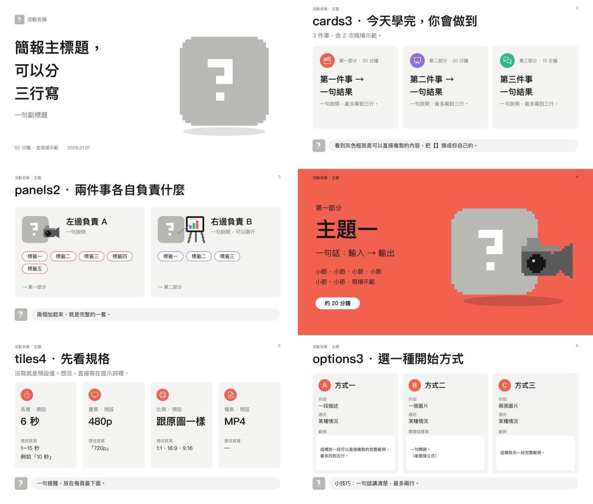

# pixel-mascot-deck

An agent skill for building PowerPoint decks (.pptx, via pptxgenjs) in a clean, white, minimal style with a
pixel-art mascot that is drawn for each deck's own topic and changes pose from part to part.



- **The mascot is new for every deck.** It's drawn with [pxl](https://github.com/crsolver/claude-pxl)
  from the topic's product, logo or character. Ready-made pose props: camera, presentation board, wrench,
  LIVE badge.
- **19 page arrangements:** cover, part divider, live-demo page, 3 cards, 4 stat tiles, option cards, 6
  steps, a formula comparing a vague and a good prompt, icon table rows, swatches, aspect-ratio frames, a
  4-frame sequence, a flow, steps with example chips, lists, choices with setup steps, a prompt chain, and
  a comparison grid.
- **Recurring pieces:** one colour per part, Lucide icons in colour circles, grey "copy this" prompt chips,
  and a mascot tip bubble.
- **Speaker notes on every slide**, starting with the time to spend on it.

More pictures: [`references/layouts-2.jpg`](references/layouts-2.jpg),
[`-3`](references/layouts-3.jpg), [`-4`](references/layouts-4.jpg). The style rules are in
[`references/style.md`](references/style.md); the agent workflow is in [`SKILL.md`](SKILL.md).

## Install

```bash
npx skills add syzoe/pixel-mascot-deck
```

Or clone it into your agent's skills folder (for example `~/.agents/skills/pixel-mascot-deck`).

## Try the example

```bash
mkdir demo && cd demo && npm init -y >/dev/null
npm i pptxgenjs react-icons react react-dom sharp jszip
NODE_PATH=$PWD/node_modules node <skill>/kit/example.js     # -> example.pptx, one slide per arrangement
<skill>/scripts/keynote_qa.sh example.pptx qa                # macOS: render through Keynote and check
```

The default font is PingFang TC, which every Mac has; set `font` in `kit.start()` for another platform
or language.
